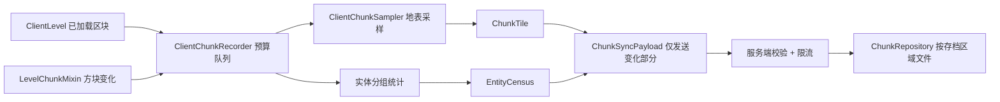

# AIGC`s Manager For Chunks And Entities

> 仓库：<https://github.com/trensjur/AIGC-Manager-For-Chunks-And-Entities>
>
> 当前版本：**0.16.1** —— 修复实体规则列表无法添加规则、区块列表操作列溢出屏幕的问题。

> [!WARNING]
> **AIGC 声明**：本模组的代码、资源与文档使用 **DeepSeek AI** 辅助生成，并经人工整理、编译与测试。
> AI 生成内容可能存在错误或遗漏；使用前请阅读下方的「AIGC 声明与免责」，并备份存档。

NeoForge 1.21.1 的**区块记录 / 世界地图 / 区块管理 / 实体统计**模组：客户端采样已加载区块并同步到服务端，服务端按存档保存区块图块与实体统计；在此数据层之上提供世界地图、实体雷达、路径点、区块认领、区块列表、实体控制与区块预加载。

## 它做了什么

| 能力 | 实现方式 |
| --- | --- |
| 客户端区块采样 | 以可配置预算扫描已加载区块，采样地表颜色、高度、起伏阴影、天空光与方块光；`LevelChunkMixin` 监听方块变化并只同步发生变化的图块与实体统计 |
| 按存档隔离的服务端存储 | 数据保存在 `<存档根目录>/m4cne/<命名空间>/<维度路径>/r.<x>.<z>.m4cr`，每个区域文件覆盖 32×32 个区块，GZIP 压缩、异步写盘、自动保存 |
| 世界地图 | `M` 键打开全屏地图，支持拖动平移、滚轮缩放、玩家箭头、区块网格、区块坐标/高度标签、群系/史莱姆/矿脉叠加层、实体雷达与右键菜单 |
| 区块认领 | 64 色玩家配色、条纹叠加层、强制加载、定时扫描、管理员命令；每个区块可独立设置边界墙与进入提示 |
| 区块列表 | 左侧列表 + 右侧按钮的两栏布局，列表占窗口横向约 2/3；认领区块与强加载区块是两个独立分页 |
| 区块ID与合并 | 每个认领区块默认 ID 为 `c<区块X>_<区块Z>`，支持多选重命名与多选合并；合并使用组内字符串排序靠前的 ID，且不要求区块相邻；只允许合并同一玩家自己的区块，合并后仅保留排序靠前 ID 的实体规则 |
| 边界墙 | 每个区块可独立开关，沿区块最外围渲染半透明、全高度的类原版世界边界墙 |
| 进入提示 | 每个区块可独立开关“进入该区块内显示提示”，显示方式可选物品栏上方 / 聊天栏 / 不显示 |
| 实体统计与雷达 | 每个区块按实体类型统计数量；雷达支持合并到区块统计或独立显示，并可选择圆点 / 图标样式 |
| 认领实体规则 | 实体规则按认领组（区块ID）生效：每行显示实体、所属玩家、自然/非自然生成、Buff、隔离与仇恨；支持添加、修改、启用/禁用与删除规则 |
| 规则编辑与效果 | 编辑界面可选择任意生物或玩家实体，设置 Buff、自然生成（仅生物）、非自然生成（仅刷怪蛋与指令，仅生物）、隔离（仅生物）与仇恨（仅生物）；Buff 只在认领组内部生效，离开后仅清除由规则提供的 Buff |
| 寻路隔离 | 隔离规则在 `PathNavigation` 层生效：区块内的生物认为区块外不可达，不会生成越界路径；另有逐刻位置钳制作为击退/传送的兜底 |
| 区块预加载 | 服务端任务：半径 1～400 区块、方形/圆形、线程/优先级/内存、游戏刻冻结、断点续跑与完成后导入地图 |
| 路径点、结构定位与传送 | 64 色盘与 10 种分类；19 种结构按世界种子定位；传送优先请求服务端解析安全落点 |
| 小地图 / 指南针 HUD | `H` 开关、`J` 切换；小地图按四角锚点贴靠，指南针以屏幕中心线为基准，均支持实体 / 路径点显示与独立布局预览 |
| 性能 | 客户端区块缓存不设上限并按 32×32 区块分区索引；颜色/高度/光照结果烘焙缓存，地图拖动时只做 GPU 缩放 |

## 世界地图（M）

右侧为原版按钮 / 滑块 / 数值输入框风格的分层设置栏，左侧为世界地图画布；画布保持 4:3～3:2 比例并尽量铺满剩余区域，窗口尺寸 / GUI 缩放变化后自动重算布局与纹理分辨率。所有整数参数直接输入并按回车（或离开输入框）确认。

| 页面 | 内容 |
| --- | --- |
| 世界地图主要设置 | 渲染设置、着色阴影系数、区块采样与渲染性能、自动/手动切换地表与洞穴、地图内 HUD 信息、立即刷新与清空缓存 |
| 实体雷达设置 | 显示模式、标记样式、图标缩放、最大标记数、采样间隔、玩家/敌对/被动/物品开关与点击信息 |
| 路径点设置 | 路径点管理器、回收站、结构定位页、显示开关与标记缩放 |
| 区块认领管理 | 显示开关、区块选择、64 色调色板、快速操作、区块列表与实体控制规则 |
| 区块预加载设置 | 范围、形状、中心、线程/优先级/内存、任务控制、导入模式与预加载标记 |
| 区块信息叠加层 | 区块网格、坐标/高度标签、群系、史莱姆区块、矿脉、按坐标查询区块 |
| 小地图/指南针 HUD 设置 | 小地图、指南针、两个独立的布局预览页 |
| 预设库与设置备份 | 10 个预设槽位，支持保存、应用、删除与恢复默认值 |

地图叠加层的区块查询支持群系、史莱姆区块状态、地表高度、实体数量/种类与矿脉方块统计，并可在地图上高亮与定位。洞穴图层按玩家高度向下扫描，以 8 格为切片粒度缓存；自动模式下玩家低于地表超过阈值时自动切换。

## 区块认领与管理

| 项目 | 说明 |
| --- | --- |
| 选择区块 | “选中当前视野”“选中玩家所在区块”等按钮；`claims.selectWithLeftDrag` 默认关闭，开启后可按住左键框选（Shift 加选、Ctrl 减选），中键始终平移 |
| 配色与显示 | 认领区域按玩家颜色（64 色，默认白色）绘制条纹，并按玩家开关绘制轮廓；右键菜单提供认领 / 取消认领 / 强制加载 / 取消强制加载 |
| 区块列表 | 左侧列表占窗口横向约 2/3，右侧为操作按钮；认领区块与强加载区块为两个独立分页，每行显示区块ID、玩家名称/UUID 与区块中心世界坐标，悬停可查看维度与各项开关 |
| 区块ID | 默认 `c<区块X>_<区块Z>`；“重命名选中区块”可把一个或多个区块改为同一 ID |
| 多选合并 | 点击“多选进行合并”后逐行多选，点击“确认多选”合并；组内字符串排序靠前的 ID 成为新 ID，相距很远的区块同样可以合并；“取消多选”退出且不合并。只允许合并同一玩家认领的区块；若不同规则组一起合并，只继承 ID 排序靠前的那一组的实体规则 |
| 边界墙 | 选中区块后点击“启用/禁用选中区块的边界”：未开启时沿区块最外围（同玩家相邻区块之间的边不绘制）渲染半透明、全高度的边界墙；已开启时关闭渲染 |
| 进入提示 | 选中区块后点击“进入该区块内显示提示”：任何玩家进入该区块时显示提示；显示方式可选物品栏上方 / 聊天栏 / 不显示，也可在客户端配置 `claims.enterMessageMode` 中设置 |
| 同步与管理 | 服务端按存档保存认领（`<存档>/m4cne/claims.json`），定时扫描（默认 10 分钟，可调）要求客户端重新上传；管理员可通过 `/m4cne claim ...` 管理 |
| 实体规则列表 | 列表占窗口横向约 2/3，右侧为“添加实体规则 / 修改选中的规则 / 启用或禁用选中的规则 / 删除选中的规则”；每行显示实体名称、生效区块的拥有者、自然生成、非自然生成、Buff 数量、隔离与仇恨，Shift/Ctrl 可多选 |
| 规则编辑 | 次级界面左侧选择任意生物实体或玩家实体（支持名称/ID 筛选与分页），右侧编辑规则开关、自然生成、非自然生成、隔离、仇恨、数量上限与 Buff 列表 |
| 规则 Buff | 生物或玩家在规则所在认领组内持续获得规则指定的 Buff；离开区块、规则被禁用或删除时立即清除，且只清除由规则提供的 Buff，玩家自行饮用的药水效果不受影响 |
| 隔离 | 仅对生物生效：在隔离区块内，生物寻路认为区块外不可达，无法离开区块；击退、传送等异常位移会被位置钳制拉回 |
| 数量上限 | 可选，按单个认领区块计数；达到上限后关闭该区块的生成并清除多余个体，低于上限后自动恢复 |
| 权限 | 认领管理权限默认等级 2，单人存档的服主始终允许；管理员可以在规则列表中切换任意玩家，并编辑其规则 |

## 区块预加载与导入

| 参数 | 说明 |
| --- | --- |
| 范围 / 形状 | 半径 1～400 区块，方形或圆形；中心可选出生点 / 玩家当前位置 / 地图标记点 |
| 性能 | 线程数量（默认硬件线程数的一半，上限为硬件线程数）、五挡线程优先级、内存上限（默认匹配实际分配内存并预留缓冲） |
| 游戏刻冻结 | 默认开启，通过原版 `/tick freeze` 与 `/tick unfreeze` 实现；任务结束或暂停时解冻 |
| 任务控制 | 开始 / 暂停 / 继续 / 取消（取消需二次点击确认）；进度以区块位图保存在 `<存档>/m4cne/preload/<维度>.json`，下次继续时从断点开始 |
| 导入 | “关闭导入 / 导入 chunky / 导入 m4cne”，可设置每 tick 导入的区块数量；导入的区块会写入客户端地图缓存并绘制在世界地图上 |
| 命令控制 | `/m4cne preload ...` 可完全脱离设置界面驱动任务，参数保存在 `<存档>/m4cne/preload/settings.json` |

## 路径点、结构定位与传送

| 功能 | 说明 |
| --- | --- |
| 路径点 | 64 色盘与 10 种分类（村庄 / 遗迹 / 宝藏 / 地牢 / 前哨 / 基地 / 矿脉 / 传送门 / 神庙 / 试炼密室），按世界保存在 `config/m4cne/waypoints/` |
| 管理器 | 新建、编辑（名称 / 颜色 / 分类 / 仅本地或同步 / 显示距离）、删除、传送到路径点 |
| 回收站 | 支持恢复、彻底删除、清空，并按 `waypoints.trashAutoClearSeconds` 自动清理 |
| 多端同步 | 路径点上传到 `<存档>/m4cne/waypoints.json`，服务端广播权威列表；删除采用“所有已知客户端同意”的策略，管理员可用 `/m4cne waypoint forceSync` 强制重新同步 |
| 结构定位 | 内置 19 种结构（村庄、海底废墟、古城、废弃矿井、雪屋、要塞、海底神殿、沙漠 / 丛林神庙、废墟传送门、女巫小屋、末地城、下界要塞、林地府邸、掠夺者前哨、埋藏的宝藏、沉船、试炼密室、堡垒遗迹），服务端按世界种子定位最近结构并自动创建对应分类的路径点；下界结构会解析安全落点 |
| 传送 | 右键快速传送、传送到路径点 / 玩家；优先请求服务端解析安全落点（`teleport_request`），服务端未安装模组时回退 `/tp`，需要权限等级 2 |

## 小地图 / 指南针 HUD

| 组件 | 说明 |
| --- | --- |
| 小地图 | 复用地图采样数据与纹理渲染器，按四角锚点（`minimap.corner`）、边距与缩放贴靠屏幕；可配置尺寸、边框、额外信息（坐标、群系、维度、区块坐标、史莱姆区块状态）、文字缩放、实体 / 路径点图标与显示范围、渲染层与打开界面时自动隐藏 |
| 指南针 | 以屏幕中心线为基准，可配置位置偏移、宽度、缩放、实体图标缩放、背景不透明度，以及实体 / 路径点的显示范围与合并像素；图标超出范围时钉在刻度带边缘，靠近朝向标记时显示名称、水平距离与高度差 |
| 布局预览 | 两个 HUD 都有独立的布局预览页，点击预览里的游戏窗口即可把 HUD 放到对应角落或位置 |
| 玩家高亮 | 地图上点击其他玩家可高亮，被高亮玩家即使超出范围也会钉在小地图 / 指南针边缘并显示名字与方向 |

## 按键

| 按键 | 功能 |
| --- | --- |
| `M` | 打开 / 关闭世界地图设置界面（可在“选项 → 控制 → 按键绑定”中修改） |
| `H` | 开启 / 关闭小地图或指南针 HUD（可改键） |
| `J` | 在小地图与指南针之间切换（可改键） |
| `N` | 打开世界地图并在玩家当前位置新建路径点（可改键） |
| `ESC` | 关闭世界地图界面（任意菜单层级） |
| `R` | 世界地图内把视图重新居中到玩家并恢复默认缩放 |

鼠标：左键拖动平移（在区块认领页开启“左键框选区块”后改为框选区块），滚轮缩放（可在“渲染设置”中恢复原方向），中键始终平移，右键弹出菜单。

## 客户端流程



## 命令

| 命令 | 权限 | 说明 |
| --- | --- | --- |
| `/m4cne here` | 所有玩家 | 查看所在区块的记录、更新时间与实体统计 |
| `/m4cne stats` | OP (2) | 查看各维度区块数、实体总数与主要实体类型 |
| `/m4cne save` | OP (2) | 立即把脏区域写入磁盘 |
| `/m4cne waypoint forceSync` | OP (2) | 强制所有在线客户端重新上传路径点 |
| `/m4cne claim scan` | 认领管理权限（默认 2） | 要求所有在线客户端重新上传认领数据 |
| `/m4cne claim list` | OP (2) | 查看认领总数、强制加载数与各玩家统计 |
| `/m4cne claim interval <seconds>` | 认领管理权限（默认 2） | 修改服务端扫描间隔（30-86400 秒） |
| `/m4cne claim clear <玩家名>` | OP (2) | 删除指定玩家的全部认领 |
| `/m4cne preload <子命令>` | 预加载权限（默认 2） | 控制区块预加载形状 / 半径 / 中心 / 性能参数与任务启停，见下方“预加载指令” |

### 预加载指令

`/m4cne preload ...` 提供与设置界面等价的控制能力，所有参数在服务端校验并保存到 `<存档>/m4cne/preload/settings.json`；权限由服务端配置 `preload.requiredPermissionLevel` 控制（单人存档的服主始终允许）。

| 子命令 | 说明 |
| --- | --- |
| `status` | 显示任务状态、维度、中心、半径、形状、进度、线程 / 优先级 / 内存、导入进度与服务端冻结状态 |
| `settings` | 显示下一次 `start` 将要使用的参数 |
| `start` | 使用当前参数开始预加载；相同区域的已有进度自动续跑 |
| `start here` | 以执行者所在维度与所在区块为中心开始预加载 |
| `pause` / `resume` / `cancel` | 暂停 / 继续 / 取消任务；`cancel` 同时删除进度记录 |
| `dimension <id>` | 设置目标维度（Tab 可补全已加载维度） |
| `center <chunkX> <chunkZ>` / `center here` | 设置中心区块 |
| `radius <1-400>` | 设置半径（区块），并提示该形状下的区块总数 |
| `shape <square\|circle>` | 设置形状：方形 / 圆形 |
| `threads <数量>` | 设置线程数（上限为 CPU 线程数） |
| `priority <lowest\|low\|normal\|high\|highest>` | 设置线程优先级 |
| `memory <MiB>` | 设置内存预算（上限为堆内存） |
| `freeze <on\|off>` | 任务运行期间是否冻结游戏刻（复用原版 tick freeze）；修改立即生效 |
| `import [off\|chunky\|m4cne] [budget]` | 关闭导入，或立即导入区块数据并指定每 tick 导入数量 |
| `reset` | 恢复默认参数（当前维度与区块、半径 128、方形、冻结开启、导入 m4cne） |

## 配置

- 客户端 `config/m4cne-client.toml`：采样预算、重采样间隔、实体过滤（客户端区块缓存不设上限），以及 `map.*` / `hud.*` / `radar.*` / `waypoints.*` / `overlay.*` / `preload.*` / `minimap.*` / `compass.*` / `claims.*` 世界地图、HUD 与认领设置。
  - `preload.*` 控制预加载半径、形状、中心来源、线程数（默认硬件线程数一半，上限为硬件线程数）、线程优先级、内存上限（默认 2 GiB，上限为堆内存的 90%）、冻结游戏刻、导入模式、导入预算与自动导入。
  - `map.overscan` / `map.settleMs` / `map.invertWheelZoom` 控制预渲染余量、重建时机与滚轮方向；`map.layerSwitchMode` / `map.manualLayer` / `map.caveSliceOffset` / `map.autoCaveDepth` 控制地表与洞穴图层。
  - `radar.displayMode`（MERGED / INDIVIDUAL）、`radar.markerStyle`（DOT / ICON）、`radar.iconScale`、`radar.maxMarkers`、`radar.sampleIntervalMs`、`radar.clickInfo` 控制实体显示与点击信息。
  - `overlay.biome` / `overlay.biomeOpacity` / `overlay.slimeChunks` / `overlay.slimeOpacity` / `overlay.oreVeins` / `overlay.queryHighlight` / `overlay.oreScanBudget` 控制区块信息叠加层。
  - `minimap.*` 控制小地图 HUD 的开关、模式、角落锚点（`minimap.corner`）、边距、尺寸、缩放、边框、额外信息、实体 / 路径点显示与渲染层。
  - `compass.*` 控制指南针的位置（`compass.posX` 为相对屏幕中心的水平偏移，`compass.posY` 为刻度带中心高度）、宽度、缩放、图标缩放、背景不透明度、实体 / 路径点显示范围与合并像素。
  - `claims.*` 控制认领叠加层与强制加载标记的显示、允许显示其他玩家、聊天进出提示、默认不透明度、是否允许左键框选区块（默认关闭），以及进入区块提示的显示方式 `claims.enterMessageMode`（物品栏上方 / 聊天栏 / 不显示）。
- 服务端 `config/m4cne-server.toml`：同步距离、每玩家更新速率、实体类型上限、自动保存间隔、内存区块上限。
  - `preload.requiredPermissionLevel` 控制预加载任务所需权限（单人存档服主始终允许）。
  - 预加载指令的参数保存在 `<存档>/m4cne/preload/settings.json`，任务进度保存在 `<存档>/m4cne/preload/<维度>.json`。
  - `claims.*` 配置认领扫描间隔、每玩家认领上限、强制加载开关与上限、认领管理权限等级，以及认领实体控制的总开关、每玩家规则上限、清理间隔与每轮清理区块数。
- 依赖数据：史莱姆区块需要世界种子，单人模式直接读取集成服务器；多人模式下模组会向服务端请求一次（服务端未安装模组时该叠加层显示为未知）。

## 兼容性说明

- **原版 / NeoForge 1.21.1**：完整支持。
- **c2me**：预加载任务会自动使用并行区块加载引擎；不注入存储层，可安全卸载。
- **Chunky**：检测到 chunky 正在预加载时会拒绝启动本模组的任务，避免重复工作。
- **客户端 / 服务端**：模组同时提供客户端与服务端功能；网络协议版本为 `12`，客户端与服务端应使用相同模组版本。
- **专用服务器**：世界地图、认领、预加载、路径点同步与实体控制由服务端提供；客户端未安装模组时仅缺少地图/HUD 功能。
- **单人存档**：服主自动拥有全部管理权限，无需额外配置。
- **其他模组**：实体控制按 `BuiltInRegistries.ENTITY_TYPE` 校验，支持模组生物；认领规则只影响被认领区块。

## 实施状态

| 阶段 | 内容 | 状态 |
| --- | --- | --- |
| 0.9.x | 区块采样、服务端存储、世界地图、实体雷达、路径点、结构定位、区块预加载 | ✅ 已完成 |
| 0.10 – 0.11 | 区块叠加层、洞穴层、区块认领、框选与认领玩家列表 | ✅ 已完成 |
| 0.12 – 0.13 | 认领实体控制、生物数量上限列表、认领 UX 调整 | ✅ 已完成 |
| 0.14.0 | 区块预加载命令、权限与完成后导入 | ✅ 已完成 |
| 0.15.0 | 区块列表双栏布局、区块ID/重命名/合并、边界墙、进入提示 | ✅ 已完成 |
| 0.16.0 | 实体规则列表与规则编辑界面、按认领组生效的生成/隔离/仇恨、规则 Buff、寻路隔离、合并规则继承 | ✅ 已完成 |
| 0.16.1 | 修复实体规则列表无法添加规则（1.21.1 `getBaseClass()` 恒为 `Entity.class`）、两栏页操作列滚动、路径点编辑器适配小窗口 | ✅ 已完成 |

## 构建

```bash
./gradlew build        # 产物在 build/libs/
./gradlew runClient    # 客户端开发环境
./gradlew runServer    # 专用服务器开发环境
./gradlew runData      # 数据生成 / Mixin 校验
```

产物位于 `build/libs/m4cne-0.16.1.jar`。

## AIGC 声明与免责

### 生成方式

本项目的源代码、资源、语言文件与文档使用 **DeepSeek AI** 辅助生成，并由维护者进行人工整理、编译与测试后发布。AI 生成内容可能包含错误、遗漏、过时信息或不符合预期的行为，**不保证**在所有 Minecraft / NeoForge / c2me / Chunky 版本组合下都能正常工作。

### 免责声明

- 本模组按 **MIT License** 的 “AS IS” 条款提供，不附带任何明示或暗示的担保，包括但不限于适销性、特定用途适用性与非侵权担保。
- 因使用或无法使用本模组而导致的**存档损坏、数据丢失、服务器崩溃、客户端异常、整合包冲突、性能问题或其他损失**，作者与贡献者不承担责任。
- 本模组会通过 Mixin、网络包、区块强制加载与实体控制等方式修改客户端与服务端行为。**请勿直接在已有重要存档上使用**；使用前请完整备份存档与服务端配置。
- AI 生成代码可能包含与特定模组版本不兼容、边界条件处理不完整或存在潜在崩溃风险的逻辑。请在**测试世界/测试服务器**中先行验证。
- 本模组不是 Mojang、Microsoft 或 NeoForged 的官方产品，也未获得上述项目的背书或认可。
- 若 AI 生成内容无意中使用了受版权保护的代码、文本或素材，请通过 GitHub Issue 联系维护者；核实后将修改或删除相关内容。
- 使用者应自行遵守 GitHub、CurseForge、Modrinth 等平台关于 AIGC 内容的政策，以及所在地区的法律法规。

### 使用注意

- 新建世界前先备份 `saves/` 与 `config/`；服务端升级前备份世界目录。
- 先在单人测试世界中验证世界地图、区块预加载、认领边界墙与实体控制，再应用到正式存档。
- 客户端与服务端应使用相同模组版本（网络协议 `11`）；版本不一致时认领、预加载与路径点同步可能失败。
- 强制加载区块与预加载任务会持续占用服务器资源，请按实际内存与 CPU 设置上限。
- 如遇到问题，请在 GitHub Issues 中提供 Minecraft/NeoForge 版本、模组列表、`latest.log` 与崩溃报告。

## 许可证与致谢

本模组以 **MIT License** 发布，完整文本见 [`LICENSE`](LICENSE)。第三方组件与构建模板的说明见 [`NOTICE.md`](NOTICE.md)。

### NeoForged MDK

- 构建模板来自 <https://github.com/NeoForged/MDK>，许可证为 **MIT License**，完整文本见 [`TEMPLATE_LICENSE.txt`](TEMPLATE_LICENSE.txt)。
- 官方 Mojang 映射名称的许可证说明见 <https://github.com/NeoForged/NeoForm/blob/main/Mojang.md>。

### 其他致谢

- **DeepSeek AI**：辅助生成本项目的代码、资源与文档。
- **NeoForge**：提供 1.21.1 模组加载器、事件与网络 API。
- **Minecraft**：Mojang / Microsoft 的商标与版权归其各自所有者所有。

