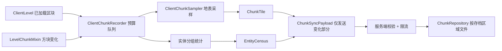

# AIGC`s M4CnE

NeoForge 1.21.1 区块记录 / 实体统计 / 地图数据核心。

## 当前核心功能

1. **客户端区块读取与变更同步**
   - 客户端以可配置的预算扫描已加载区块，采样地表高度、颜色、起伏阴影、天空光与方块光。
   - `LevelChunkMixin` 监听客户端方块状态变化；方块放置/破坏（包括区块边界，影响邻区块阴影）会立即进入重采样队列。
   - 只把发生变化的图块/实体统计发送到服务端，避免重复传输。
2. **实体统计**
   - 每个区块按实体类型统计数量（默认包含玩家、生物、掉落物、弹射物等全部类型）。
   - 客户端缓存 `ClientChunkStore` 可按区块查询图块与实体统计，作为后续世界地图 / 实体雷达的数据源。
3. **按存档隔离的服务端存储**
   - 数据保存在 `<存档根目录>/m4cne/<命名空间>/<维度路径>/r.<x>.<z>.m4cr`。
   - 每个区域文件覆盖 32×32 个区块，GZIP 压缩、异步写盘、自动保存、脏区域淘汰与内存上限保护。
   - 两个不同存档（即使显示名称相同）使用不同目录，不会互相覆盖。
4. **世界地图与分层设置界面（M 键）**
   - 右侧为原版按钮 / 滑块 / 数值输入框风格的分层设置栏，左侧为世界地图画布；画布保持 4:3～3:2 比例并尽量铺满剩余区域，窗口尺寸 / GUI 缩放变化后自动重算布局与纹理分辨率。
   - 所有整数参数不再使用滑块：直接在输入框中输入数值，按回车（或离开输入框）即可确认。
   - 一级菜单：世界地图主要设置、实体雷达设置、路径点设置、区块认领管理、区块预加载设置、区块信息叠加层、小地图/指南针HUD设置、预设库与设置备份。
   - 二级菜单显示“世界地图设置 > 当前页”路径与返回按钮；ESC 始终直接关闭整个界面，M（可改键）再次按下也会关闭。
   - 世界地图主要设置包含：渲染设置、着色阴影系数、区块采样与渲染性能配置、自动/手动切换地表与洞穴、地图内 HUD 信息、立即刷新与清空客户端缓存（原“HUD设置”菜单已并入此页）；整数参数全部改为直接输入并按回车确认。
   - 地图支持拖动平移、滚轮缩放、玩家位置箭头、区块网格、区块坐标与地表高度标签、群系叠加层、史莱姆区块叠加层、矿脉叠加层、实体雷达、右键添加路径点、HUD 信息与文字缩放。
   - 区块信息叠加层支持按区块坐标查询指定区块：群系、史莱姆区块状态、地表高度、实体数量/种类与矿脉方块统计，并可在地图上高亮与定位。
   - 洞穴图层按玩家高度向下扫描地表方块，以 8 格为切片粒度缓存；自动模式下玩家低于地表超过阈值时自动切换。
   - 设置预设保存在 `config/m4cne/presets.json`，路径点按世界保存在 `config/m4cne/waypoints/`。
5. **渲染与性能**
   - 地图纹理始终以 0..1 的 UV 覆盖整块画布，修复了此前低分辨率设置下地图重复平铺成四块的问题。
   - 地图纹理按“世界坐标”固定并预渲染可视区域外的余量（`map.overscan`）：拖动 / 缩放时只做 GPU 缩放，相机停止后才重建纹理，因此交互帧率稳定。
   - 每个区块的着色、阴影、高度与光照结果烘焙进 `ChunkColorCache`，重建时只做整数拷贝；昼夜亮度以单层半透明遮罩绘制，不会使缓存失效。
   - 客户端区块缓存不再设上限；缓存按 32×32 区块分区索引，地图只遍历可视区域。极限缩小时改为按纹理像素采样，重建开销不再随缓存规模线性增长；同时复用采样阶段已算好的图块指纹，避免重复计算。
6. **实体显示**
   - “合并到区块内统计”按区块聚合显示（原逻辑）；“独立显示”把每个已采样实体拆分绘制，可选择“以点的形式显示”或“以图标的形式显示”，图标缩放系数可调。
   - 进入世界时对全部已注册实体（含模组实体）采样一次静态图标（刷怪蛋 / 玩家头颅，缺失时回退）并缓存，之后每帧只做查表。
7. **小地图 / 指南针 HUD**
   - 默认 `H` 开关 HUD，默认 `J` 在小地图与指南针之间切换，均为可改键。
   - 小地图直接复用地图采样数据与纹理渲染器，按四角锚点（`minimap.corner`）、边距与缩放贴靠屏幕，可配置尺寸、边框、额外信息（坐标、群系、维度、区块坐标、史莱姆区块状态）、文字缩放、实体 / 路径点图标与显示范围、渲染层（HUD 之上 / 之下）以及打开任意界面时自动隐藏。
   - 指南针以屏幕中心线为基准，可配置位置偏移、宽度、缩放、实体图标缩放、背景不透明度，以及实体 / 路径点的显示范围与合并像素；图标超出范围时钉在刻度带边缘，靠近朝向标记时显示名称、水平距离与高度差。
   - 两个 HUD 都有独立的布局预览页：点击预览里的游戏窗口即可把 HUD 放到对应角落或位置。
   - 在地图上点击其他玩家可高亮，被高亮玩家即使超出范围也会钉在小地图 / 指南针边缘并显示名字与方向。
8. **按钮悬浮提示**
   - 设置面板中的所有按钮、开关、滑块、数值输入框、文本输入与菜单入口都带有随本地化变化的鼠标停留提示。
9. **区块预加载（重做）**
   - 一级菜单“区块预加载设置”的旧选项已全部移除，改为完整的服务端预加载任务：调用区块加载引擎（安装 c2me 时自动由其并行引擎执行）预生成指定范围；检测到 chunky 正在预加载时会拒绝启动本模组的任务，避免重复工作。
   - 范围：半径 1～400 区块、方形 / 圆形、中心可选“出生点 / 玩家当前位置 / 地图标记点”。
   - 性能：线程数量（默认硬件线程数的一半，上限为硬件线程数）、五挡线程优先级（默认中间挡）、内存上限（上限自动匹配游戏实际分配内存并预留 10% 缓冲）。
   - “冻结游戏逻辑帧”（默认开启）通过原版 `/tick freeze` 与 `/tick unfreeze` 实现：任务运行时冻结游戏刻，任务结束或暂停时解冻。
   - 任务控制：开始 / 暂停 / 继续 / 取消（取消需二次点击确认）；进度以区块位图保存在 `<存档>/m4cne/preload/<维度>.json`，下次继续时从断点开始；取消会删除进度记录并清空客户端区块缓存。
   - 可视化：地图上绘制预加载范围线框与中心十字、范围进度标签；设置栏显示已加载区块数、总区块数与百分比。
   - 命令控制：`/m4cne preload ...` 可以完全脱离设置界面驱动任务，设置维度、中心区块、半径、形状、线程、优先级、内存、冻结与导入参数，并开始 / 暂停 / 继续 / 取消任务；参数保存在 `<存档>/m4cne/preload/settings.json`，相同区域的任务会自动续跑已有进度（详见下方“预加载指令”）。
   - 导入并绘制：导入模式“关闭导入 / 导入 chunky / 导入 m4cne”，可设置每 tick 导入的区块数量。`导入 m4cne` 在任务完成后自动执行（可用 `preload.autoImportOnFinish` 关闭），`导入 chunky` 与手动导入按钮随时可用；导入的区块会写入客户端地图缓存并绘制在世界地图上，即使范围远超玩家渲染距离。
10. **地图右键菜单**
   - 右击选中的区域：认领 / 取消认领 / 强制加载 / 取消强制加载 / 清除选择。
   - 右击已认领区块显示所属玩家与强制加载状态。
   - 右击路径点：传送到该路径点、移入回收站；右击其他玩家：高亮 / 取消高亮、传送到该玩家。
   - 右击任意位置：快速传送、在此添加路径点、将此处标记为预加载中心。
   - 再次右击已存在的亮色中心点可“设为中心”或“删除此标记”；标记按世界与维度保存在 `config/m4cne/preload_markers/`。
11. **区块认领与实体控制**
   - 选择区块：使用“选中当前视野”“选中玩家所在区块”等按钮；`claims.selectWithLeftDrag` 默认关闭，开启后也可按住左键在地图上框选（Shift 加选、Ctrl 减选），中键始终平移地图。
   - 认领 / 取消认领 / 强制加载 / 取消强制加载；认领区域按玩家颜色（64 色，默认白色）绘制条纹，并为开启了边界标记的玩家绘制轮廓（地图侧不再提供“绘制认领边界”总开关），右键菜单提供快捷操作。
   - **区块列表**：认领页的“区块列表”采用左侧列表 + 右侧按钮的两栏布局，列表占窗口横向约 2/3；认领区块与强加载区块是两个独立分页，每行显示区块ID、所属玩家与区块中心的世界坐标（悬停可查看玩家 UUID、维度与各项开关）。
   - **区块ID与合并**：每个认领区块都有独立ID（默认 `c<区块X>_<区块Z>`），可多选后重命名；“多选进行合并”逐行多选后点击“确认多选”，组内字符串排序靠前的ID成为合并后的新ID，相距很远的区块同样可以合并；“取消多选”直接退出多选且不执行合并。
   - **边界墙**：每个区块可独立开启/关闭边界墙，开启后沿区块最外围（同玩家相邻区块之间的边不绘制）渲染半透明、全高度的类似原版世界边界的墙面。
   - **进入提示**：每个区块可独立开启 “进入该区块内显示提示”，任何玩家进入后都会收到提示；显示方式可在“区块列表”右侧或客户端配置 `claims.enterMessageMode` 中选择“物品栏上方 / 聊天栏 / 不显示”。
   - 服务端按存档保存认领（`<存档>/m4cne/claims.json`），定时扫描（默认 10 分钟，可调）要求客户端重新上传，管理员可通过 `/m4cne claim ...` 管理。
   - 认领者在“实体控制规则”页面可以：总开关、允许/禁止生物生成、开启/关闭“站在自己认领区块内时生物不再仇恨自己”、允许/禁止生物进入或离开认领区块；强制加载的认领区块可单独禁止生成。
   - **生物数量上限列表**：每条规则针对一种生物（例如 `minecraft:zombie` 上限 3），按单个认领区块计数。数量达到上限后该区块的生成机制立即关闭：自然刷怪、刷怪蛋、刷怪箱、指令与繁殖全部被拒绝，并自动清除多余个体直到数量回落到上限；数量低于上限后自动恢复生成。列表可添加任意多条规则，快捷列表覆盖当前游戏全部生物（含模组生物），新增规则默认上限为 3。
   - 另有“生物生成/仇恨规则”列表，可对任意生物单独关闭生成或仇恨；两个列表共用同一份每生物规则数据，服务端会校验实体类型并限制每玩家规则条数。
   - 服务端管理员权限（默认等级 2，单人存档的服主始终允许）可以在认领玩家列表中选择任意玩家，编辑其全部实体控制规则。
12. **路径点、结构定位与传送**
   - 64 色盘与 10 种分类（村庄 / 遗迹 / 宝藏 / 地牢 / 前哨 / 基地 / 矿脉 / 传送门 / 神庙 / 试炼密室），路径点按世界保存在 `config/m4cne/waypoints/`。
   - 路径点管理器：新建、编辑（名称 / 颜色 / 分类 / 仅本地或同步 / 显示距离）、删除、传送到路径点；回收站支持恢复、彻底删除、清空，并按 `waypoints.trashAutoClearSeconds` 自动清理。
   - 多端同步：路径点上传到 `<存档>/m4cne/waypoints.json`，服务端广播权威列表；删除采用“所有已知客户端同意”的策略，管理员可用 `/m4cne waypoint forceSync` 强制重新同步。
   - 结构定位页内置 19 种结构（村庄、海底废墟、古城、废弃矿井、雪屋、要塞、海底神殿、沙漠 / 丛林神庙、废墟传送门、女巫小屋、末地城、下界要塞、林地府邸、掠夺者前哨、埋藏的宝藏、沉船、试炼密室、堡垒遗迹；村庄 / 海底废墟 / 废弃矿井 / 废墟传送门 / 沉船使用原版结构标签覆盖全部群系变体），服务端按世界种子定位最近结构并自动创建对应分类的路径点，下界结构会解析安全落点。
   - 传送：右键快速传送、传送到路径点 / 玩家；优先请求服务端解析安全落点（`teleport_request`），服务端未安装模组时回退 `/tp`，需要权限等级 2。

## 按键

| 按键 | 功能 |
| --- | --- |
| `M` | 打开 / 关闭世界地图设置界面（可在“选项 → 控制 → 按键绑定”中修改） |
| `H` | 开启 / 关闭小地图或指南针 HUD（可改键） |
| `J` | 在小地图与指南针之间切换（可改键） |
| `N` | 打开世界地图并在玩家当前位置新建路径点（可改键） |
| `ESC` | 关闭世界地图界面（任意菜单层级） |
| `R` | 世界地图内把视图重新居中到玩家并恢复默认缩放 |

鼠标：左键拖动平移（在区块认领页开启“左键框选区块”后改为框选区块），滚轮缩放（可在“渲染设置”中恢复原方向），中键始终平移，右键弹出菜单。

## 客户端流程



## 命令

| 命令 | 权限 | 说明 |
| --- | --- | --- |
| `/m4cne here` | 所有玩家 | 查看所在区块的记录、更新时间与实体统计 |
| `/m4cne stats` | OP (2) | 查看各维度区块数、实体总数与主要实体类型 |
| `/m4cne save` | OP (2) | 立即把脏区域写入磁盘 |
| `/m4cne waypoint forceSync` | OP (2) | 强制所有在线客户端重新上传路径点 |
| `/m4cne claim scan` | 认领管理权限（默认 2） | 要求所有在线客户端重新上传认领数据 |
| `/m4cne claim list` | OP (2) | 查看认领总数、强制加载数与各玩家统计 |
| `/m4cne claim interval <seconds>` | 认领管理权限（默认 2） | 修改服务端扫描间隔（30-86400 秒） |
| `/m4cne claim clear <玩家名>` | OP (2) | 删除指定玩家的全部认领 |
| `/m4cne preload <子命令>` | 预加载权限（默认 2） | 控制区块预加载形状 / 半径 / 中心 / 性能参数与任务启停，见下方“预加载指令” |

### 预加载指令

`/m4cne preload ...` 提供与设置界面等价的控制能力，所有参数在服务端校验并保存到 `<存档>/m4cne/preload/settings.json`；权限由服务端配置 `preload.requiredPermissionLevel` 控制（单人存档的服主始终允许）。

| 子命令 | 说明 |
| --- | --- |
| `status` | 显示任务状态、维度、中心、半径、形状、进度、线程 / 优先级 / 内存、导入进度与服务端冻结状态 |
| `settings` | 显示下一次 `start` 将要使用的参数 |
| `start` | 使用当前参数开始预加载；相同区域的已有进度自动续跑 |
| `start here` | 以执行者所在维度与所在区块为中心开始预加载 |
| `pause` / `resume` / `cancel` | 暂停 / 继续 / 取消任务；`cancel` 同时删除进度记录 |
| `dimension <id>` | 设置目标维度（Tab 可补全已加载维度） |
| `center <chunkX> <chunkZ>` / `center here` | 设置中心区块 |
| `radius <1-400>` | 设置半径（区块），并提示该形状下的区块总数 |
| `shape <square\|circle>` | 设置形状：方形 / 圆形 |
| `threads <数量>` | 设置线程数（上限为 CPU 线程数） |
| `priority <lowest\|low\|normal\|high\|highest>` | 设置线程优先级 |
| `memory <MiB>` | 设置内存预算（上限为堆内存） |
| `freeze <on\|off>` | 任务运行期间是否冻结游戏刻（复用原版 tick freeze）；修改立即生效 |
| `import [off\|chunky\|m4cne] [budget]` | 关闭导入，或立即导入区块数据并指定每 tick 导入数量 |
| `reset` | 恢复默认参数（当前维度与区块、半径 128、方形、冻结开启、导入 m4cne） |

## 配置

- 客户端 `config/m4cne-client.toml`：采样预算、重采样间隔、实体过滤（客户端区块缓存不设上限），以及 `map.*` / `hud.*` / `radar.*` / `waypoints.*` / `overlay.*` / `preload.*` / `minimap.*` / `compass.*` / `claims.*` 世界地图、HUD 与认领设置。
  - `preload.*` 控制预加载半径、形状、中心来源、线程数（默认硬件线程数一半，上限为硬件线程数）、线程优先级、内存上限（默认 2 GiB，上限为堆内存的 90%）、冻结游戏刻、导入模式、导入预算与自动导入。
  - `map.overscan` / `map.settleMs` / `map.invertWheelZoom` 控制预渲染余量、重建时机与滚轮方向；`map.layerSwitchMode` / `map.manualLayer` / `map.caveSliceOffset` / `map.autoCaveDepth` 控制地表与洞穴图层。
  - `radar.displayMode`（MERGED / INDIVIDUAL）、`radar.markerStyle`（DOT / ICON）、`radar.iconScale`、`radar.maxMarkers`、`radar.sampleIntervalMs`、`radar.clickInfo` 控制实体显示与点击信息。
  - `overlay.biome` / `overlay.biomeOpacity` / `overlay.slimeChunks` / `overlay.slimeOpacity` / `overlay.oreVeins` / `overlay.queryHighlight` / `overlay.oreScanBudget` 控制区块信息叠加层。
  - `minimap.*` 控制小地图 HUD 的开关、模式、角落锚点（`minimap.corner`）、边距、尺寸、缩放、边框、额外信息、实体 / 路径点显示与渲染层。
  - `compass.*` 控制指南针的位置（`compass.posX` 为相对屏幕中心的水平偏移，`compass.posY` 为刻度带中心高度）、宽度、缩放、图标缩放、背景不透明度、实体 / 路径点显示范围与合并像素。
  - `claims.*` 控制认领叠加层与强制加载标记的显示、允许显示其他玩家、聊天进出提示、不透明度，以及“左键框选区块”（默认关闭）。
- 服务端 `config/m4cne-server.toml`：同步距离、每玩家更新速率、实体类型上限、自动保存间隔、内存区块上限。
  - `preload.requiredPermissionLevel` 控制预加载任务所需权限（单人存档服主始终允许）。
  - 预加载指令的参数保存在 `<存档>/m4cne/preload/settings.json`，任务进度保存在 `<存档>/m4cne/preload/<维度>.json`。
  - `claims.*` 配置认领扫描间隔、每玩家认领上限、强制加载开关与上限、认领管理权限等级，以及认领实体控制的总开关、每玩家规则上限、清理间隔与每轮清理区块数。
- 依赖数据：史莱姆区块需要世界种子，单人模式直接读取集成服务器；多人模式下模组会向服务端请求一次（服务端未安装模组时该叠加层显示为未知）。

## 后续（次要功能）

已实现世界地图、实体雷达、路径点管理 / 结构定位、设置预设、区块预加载 / 导入、区块认领（含按生物的数量上限列表）、实体控制与安全传送。后续可在此数据层上继续扩展认领区块的建筑权限、容器访问权限与更多传送管理功能。

## 构建

```bash
./gradlew build
```

产物位于 `build/libs/m4cne-0.15.0.jar`。

---

模板安装说明与映射许可信息见下方原模板内容。

Installation information
=======

This template repository can be directly cloned to get you started with a new
mod. Simply create a new repository cloned from this one, by following the
instructions provided by [GitHub](https://docs.github.com/en/repositories/creating-and-managing-repositories/creating-a-repository-from-a-template).

Once you have your clone, simply open the repository in the IDE of your choice. The usual recommendation for an IDE is either IntelliJ IDEA or Eclipse.

If at any point you are missing libraries in your IDE, or you've run into problems you can
run `gradlew --refresh-dependencies` to refresh the local cache. `gradlew clean` to reset everything 
{this does not affect your code} and then start the process again.

Mapping Names:
============
By default, the MDK is configured to use the official mapping names from Mojang for methods and fields 
in the Minecraft codebase. These names are covered by a specific license. All modders should be aware of this
license. For the latest license text, refer to the mapping file itself, or the reference copy here:
https://github.com/NeoForged/NeoForm/blob/main/Mojang.md

Additional Resources: 
==========
Community Documentation: https://docs.neoforged.net/  
NeoForged Discord: https://discord.neoforged.net/
